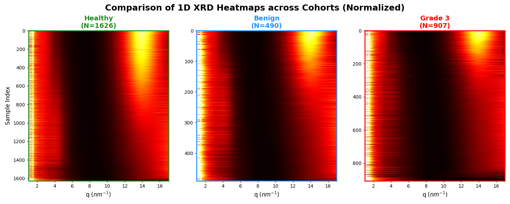

# Our data match synchrotron and ex-vivo data {#sec-other-data}

```{python}
#| include: false
from cohort_common import *
usable_results = rule_results(WATER_MIN, CENTRE_MIN)
```

::: {.callout-note title="Finding 2"}
The wettest 15% of our samples order as NORMAL &lt; BENIGN &lt; CANCER (@fig-cohort, @fig-top15), matching the synchrotron and Keele ex-vivo
ordering of less fat and more water towards disease (@fig-synchrotron, @fig-keele). Under the fixed water-peak threshold of @sec-the-rule,
BENIGN and CANCER look almost the same and the paired test only supports **CANCER vs NORMAL**; BENIGN vs NORMAL is
`{python} rule_text(usable_results, "BENIGN vs NORMAL")` and CANCER vs BENIGN `{python} rule_text(usable_results, "CANCER vs BENIGN")`, neither
above chance (@sec-glandular-details).
:::

## Synchrotron data

@fig-synchrotron shows the molecular form factors of excised breast tissue measured with synchrotron radiation by Conceição, Poletti and
colleagues [[10]](#references) [[11]](#references); the dataset was supplied by A. L. C. Conceição.
Their discriminant analysis found the ratio of the peaks at q = 19.8 and 13.9 nm⁻¹, the water and fat peaks, to be one of the features that
best separates the tissue types [[11]](#references), as earlier synchrotron work had also found [[12]](#references). The normal tissues (peripheral normal, adipose and glandular)
are dominated by the fat peak at q ≈ 14 nm⁻¹ and fall away above q ≈ 17. Malignant tissue has a much weaker fat peak and a broad water peak around q ≈ 19-20,
and benign tissue lies between the two. Tissue with less fat and more water has a higher water peak relative to its fat peak.

The right panel prepares the synchrotron curves **exactly as our scans**: the same peak-shift correction (fat peak moved to q = 14 nm⁻¹) and the
same min-max normalisation (@sec-preparation). The comparison with @fig-top15 is therefore like for like.

```{python}
#| label: fig-synchrotron
#| fig-cap: "Synchrotron form factors of breast tissue [10, 11]: the mean of each tissue type, with ±1 standard deviation shaded. **Left**: as measured. **Right**: prepared exactly like our scans (fat peak moved to q = 14, then 0 at the trough and 1 at the fat peak), for direct comparison with @fig-top15; curves without a clear fat peak cannot be prepared this way and are left out."
import zipfile
import xml.etree.ElementTree as ET

ANDRE = DATA_DIR / "Andre_FormFactor_dataset.xlsx"  # sheet 1: q, then one column per sample; sheet 2: each sample's label and classification
ns = {"m": "http://schemas.openxmlformats.org/spreadsheetml/2006/main"}

with zipfile.ZipFile(ANDRE) as zf:
    shared = ["".join(t.text or "" for t in si.findall(".//m:t", ns))
              for si in ET.fromstring(zf.read("xl/sharedStrings.xml")).findall("m:si", ns)]

    def cell_val(c):
        v = c.find("m:v", ns)
        if v is None or v.text is None:
            return None
        if c.attrib.get("t") == "s":
            return shared[int(v.text)]
        try:
            return float(v.text)
        except ValueError:
            return v.text

    def load_sheet(name):
        sheet = ET.fromstring(zf.read(f"xl/worksheets/{name}"))
        return [{"".join(ch for ch in c.attrib.get("r", "") if ch.isalpha()): cell_val(c) for c in row.findall("m:c", ns)}
                for row in sheet.findall("m:sheetData/m:row", ns)]

    sheet1 = load_sheet("sheet1.xml")
    sheet2 = load_sheet("sheet2.xml")

meta = {}
for row in sheet2[1:]:
    sid = str(row.get("A", "")).strip().replace(" ", "")
    if sid:
        meta[sid] = (str(row.get("B", "")).strip(), str(row.get("C", "")).strip().lower())

col_to_sample = {col: str(name).replace(" ", "") for col, name in sheet1[0].items() if col != "A"}
andre_q = []
series = {col: [] for col in col_to_sample}
for row in sheet1[1:]:
    if row.get("A") is None:
        continue
    andre_q.append(float(row["A"]))
    for col in col_to_sample:
        v = row.get(col)
        series[col].append(np.nan if v is None else float(v))
andre_q = np.asarray(andre_q)

groups = {"peripheral normal": [], "normal adipose": [], "normal glandular": [], "malignant": [], "benign": []}
for col, sid in col_to_sample.items():
    if sid not in meta:
        continue
    lab, cls = meta[sid]
    y = np.asarray(series[col], dtype=float)
    if lab == "peripheral_normal_tissue":
        groups["peripheral normal"].append(y)
    elif lab == "normal_adipose":
        groups["normal adipose"].append(y)
    elif lab == "normal_glandular":
        groups["normal glandular"].append(y)
    elif cls == "malignant":
        groups["malignant"].append(y)
    elif cls == "benign":
        groups["benign"].append(y)

andre_colours = {"peripheral normal": "#2c7bb6", "normal adipose": "#1a9641", "normal glandular": "#a6d96a",
                 "malignant": "#d7191c", "benign": "#fdae61"}

# the same preparation as our scans: fit the fat peak (Gaussian + straight line over q 10-17.5), move it to q = 14, then min-max normalise
import nova_sdd_peak_align as align

def prepared(curve):
    """The curve on andre_q with its fat peak moved to q = 14 and stretched (0 at the trough, 1 at the fat peak), or None without a clear fat peak."""
    fit = align.fit_peak(andre_q, curve)
    if fit is None or not (align.SIGMA_RANGE[0] <= fit["sigma"] <= align.SIGMA_RANGE[1]) \
            or not (align.FAT_WINDOW[0] < fit["peak"] < align.FAT_WINDOW[1]):
        return None
    shifted_q = andre_q * align.TARGET_Q / fit["peak"]
    refit = align.fit_peak(shifted_q, curve)
    if refit is None:
        return None
    stretched = ne.normalised_curve(shifted_q, curve, refit["value"], "stretch")
    return None if stretched is None else np.interp(andre_q, shifted_q, stretched, left=np.nan, right=np.nan)

prepared_groups = {name: [p for p in map(prepared, curves) if p is not None] for name, curves in groups.items()}

plt.rcParams["font.size"] = 7  # small text to match the other figures at A4 width
fig, (raw_ax, prep_ax) = plt.subplots(1, 2, figsize=(8, 3.8))
for ax, these in ((raw_ax, groups), (prep_ax, prepared_groups)):
    for name, curves in these.items():
        mat = np.vstack(curves)
        mean, std = np.nanmean(mat, axis=0), np.nanstd(mat, axis=0)
        left_out = len(groups[name]) - len(curves)
        note = f", {left_out} without a clear fat peak left out" if left_out else ""
        ax.plot(andre_q, mean, lw=1.8, color=andre_colours[name], label=f"{name} (n = {len(curves)}{note})")
        ax.fill_between(andre_q, mean - std, mean + std, color=andre_colours[name], alpha=0.15, linewidth=0)
    ax.set(xlabel="q (nm⁻¹)", xlim=(0, 25))
    ax.set_ylim(bottom=0)
    ax.grid(alpha=0.3)
    ax.legend(frameon=False, fontsize=6)
raw_ax.set(ylabel="Intensity (a.u.)", title="As measured")
prep_ax.axvline(14, color="black", ls="--", lw=0.8)
prep_ax.set(ylabel="I(q), stretched (fat peak = 1)", ylim=(-0.05, 1.6), title="Prepared like our scans")
fig.tight_layout()
plt.show()
plt.rcParams["font.size"] = 10
```

## Keele ex-vivo data

@fig-keele shows ex-vivo scans of breast tissue measured at Keele University [[13]](#references), one heatmap each for Healthy, Benign and grade 3
cancer tissue, each row one normalised scan.

**The water peak is missing from these scans**: they stop at q ≈ 17 nm⁻¹, below the water peak at q ≈ 20-22, so we cannot see the water
rise directly. **The reduction in the fat peak, however, is clear**: in the Healthy tissue a large share of the scans are dominated by a bright
fat peak at q ≈ 14, in Benign it covers fewer, and in the grade 3 cancer it covers a smaller share still. Less fat is the other side of the same
change that our water-rich scans and the synchrotron data show as a higher water peak.

{#fig-keele}
