# Simulating a Human 2.0 map {#sec-simulation}

::: {.callout-note title="A worked example of the map, not a patient result"}
The first map is a breast with a **2 cm** tumour. Two million photons is what the real instrument collects in **1 second**, so each
step of the map is 1 s of beam time. This breast was stepped at **5 mm**, and only where it is **2 cm or thicker**: **166 steps**, which is
**166 seconds (2 min 46 s)**. A dense breast with a **2 cm** tumour follows. The comparison with each breast once the tumour is removed is at the end.
:::

The simulator builds a 3D breast from adipose and a branching glandular network, and can add a tumour of any chosen size. The volume used here
is a **half breast**: semi-axes 5.5 cm in x and y, height 5.5 cm, voxels of 5 mm, on a 24 × 12 × 12 grid at 0.5 cm (@fig-sim-phantom). Materials
are assigned per voxel (adipose, then glandular).

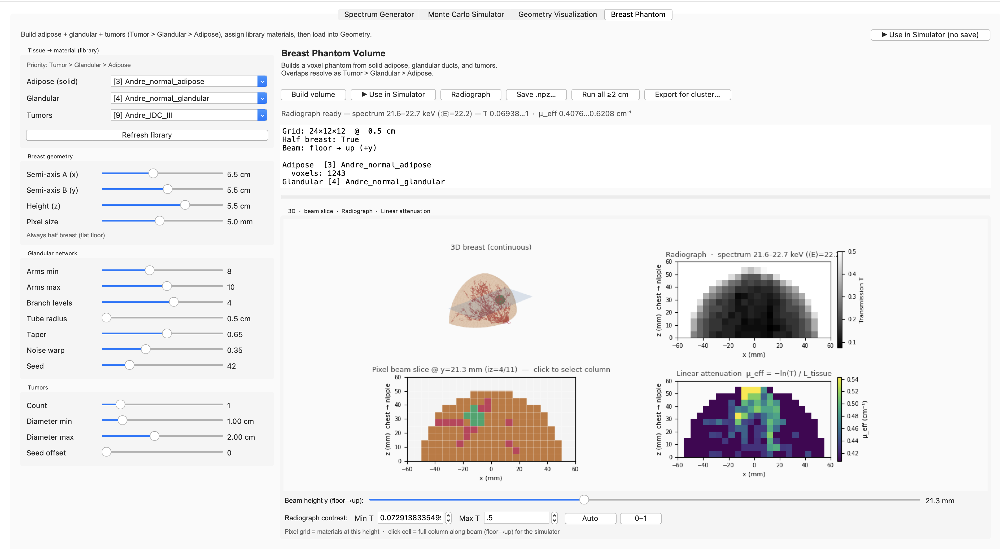{#fig-sim-phantom}

A run has two stages. First the photons interact in the breast and are stored. Then they are passed to a detector. The detector and the
sample-to-detector distance can be changed after the breast has been simulated, without repeating it. The detector here is the **CdTe Dectris
500K** that Human 2.0 will move to.

@fig-sim-one-point is one such run, 2 million photons, aimed at a **very fatty** part of this breast. About 16% of the beam is transmitted, and
the 1D curve has the fat peak near q = 14 nm⁻¹ and little water, the same shape as the fatty scans in the real data.

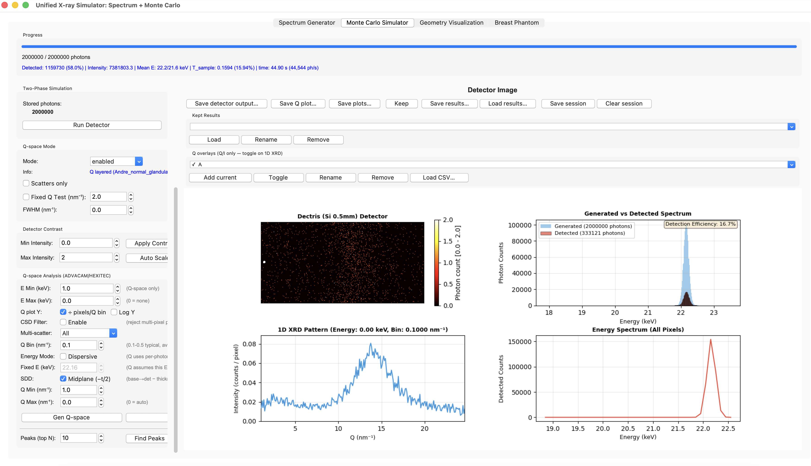{#fig-sim-one-point}

## A map of every thick point

The same 2-million-photon run was repeated on the UCL cluster at every point of this breast that is 2 cm or thicker. That is the scan proposed
for Human 2.0 (@sec-mapping): leave out the thin edge, and give each remaining point one second. At 5 mm steps that is 166 points, so **2 min
46 s** of beam time, inside the 5-minute limit.

This map is a breast with a **2 cm** tumour (@fig-sim-tumour-2cm). Each simulated point was prepared exactly as a real scan: the
fat peak was shifted to q = 14 nm⁻¹, and the curve was normalised the same way. Thickness and transmission give the linear attenuation,
μ = −ln(T) / thickness. A 3 × 3 kernel, nine neighbouring points, was slid over every position, and the search keeps the highest Water:Fat
automatically.

@fig-sim-maps puts the two readings of this breast side by side. On the left, linear attenuation behaves like a mammogram: glandular tissue
and the tumour are both dense, so both are bright. On the right, the 3 × 3 kernel map stays low over the rest of the breast, and the red box
is the kernel the search kept. It sits on the tumour.

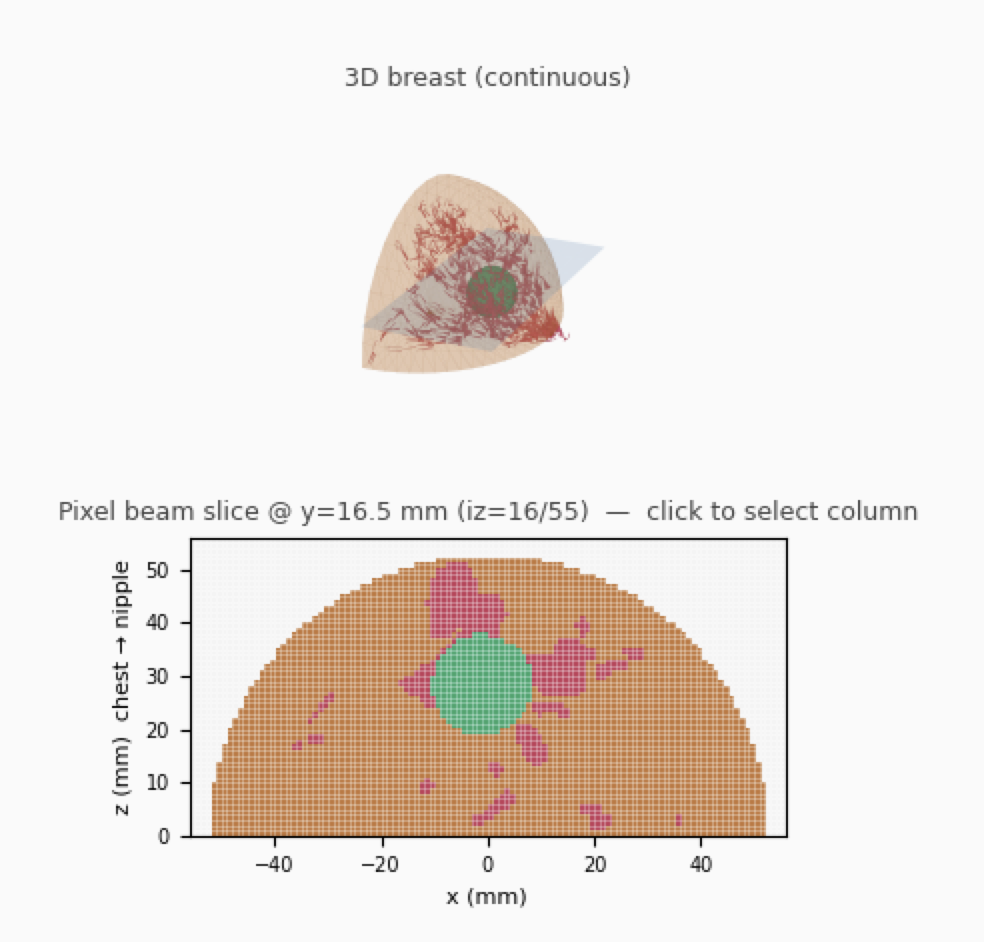{#fig-sim-tumour-2cm}

::: {#fig-sim-maps layout-ncol="2"}
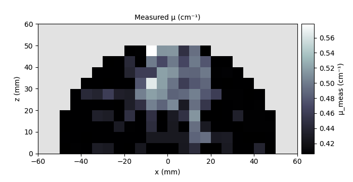

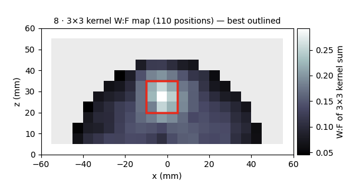

Linear attenuation and the 3 × 3 kernel map of the breast with the 2 cm tumour. Left: dense tissue, glandular and tumour together, as on a mammogram. Right: the kernel the search kept, outlined, on the tumour.
:::

## A dense breast, with a 2 cm tumour

@fig-sim-dense is a dense breast: glandular tissue fills much more of the slice, and a **2 cm** tumour sits in it. @fig-sim-maps-dense is the same pair of readings as @fig-sim-maps. With more glandular tissue, linear attenuation shows one broad dense region, so the tumour is harder to separate from the tissue around it. The 3 × 3 search still outlines it. The red box is that kernel, Water:Fat **0.337**, on the tumour.

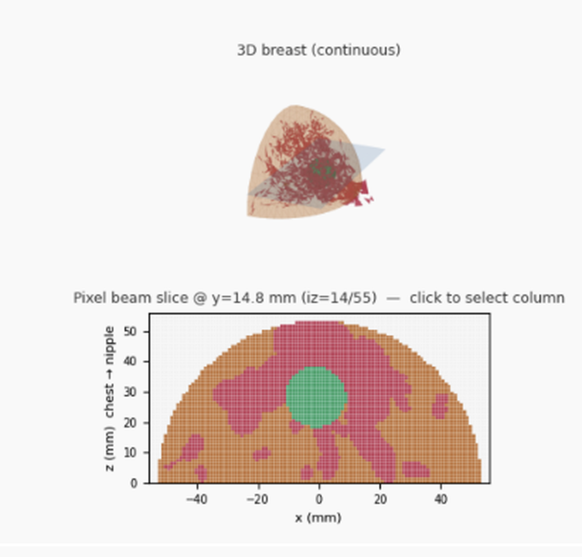{#fig-sim-dense}

::: {#fig-sim-maps-dense layout-ncol="2"}
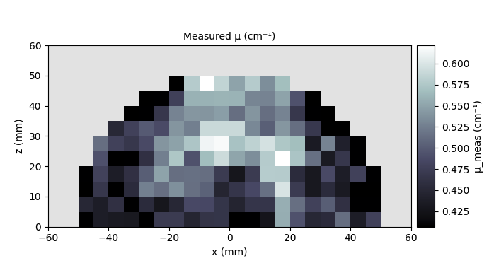

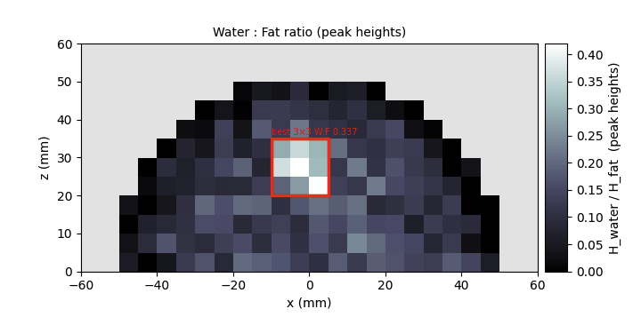

Linear attenuation and the 3 × 3 kernel map of the dense breast with a 2 cm tumour. Left: glandular tissue and the tumour form one dense region. Right: the kernel the search kept, Water:Fat 0.337, on the tumour.
:::

## Compared with no tumour

The same 3 × 3 search, on the same breast with the tumour removed and nothing else changed. With a tumour the summed curve rises through the water band. Without one it stays with the global mean, and the breast would fall on the fatty side of the top 15% cut (@sec-water-rich) and of the water-peak rule at 0.35 (@sec-the-rule, @fig-missed-normal-normal).

### The less dense breast

@fig-sim-kernel-2cm is the less dense breast with the 2 cm tumour. The kernel the search keeps has Water:Fat **0.292**. @fig-sim-kernel-2cm-none is that breast with the tumour removed. The wettest kernel is then **0.176**, and the red curve lies on the global mean through the water band.

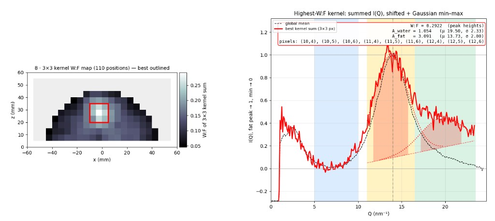{#fig-sim-kernel-2cm}

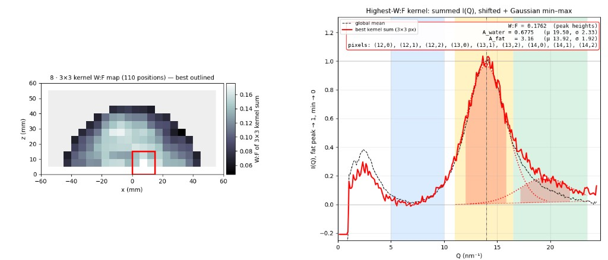{#fig-sim-kernel-2cm-none}

### The dense breast

@fig-sim-kernel-dense is the dense breast with the 2 cm tumour. The kernel the search keeps has Water:Fat **0.337**. @fig-sim-kernel-dense-none is that breast with the tumour removed. The wettest kernel is then **0.192**, and the red curve stays with the global mean.

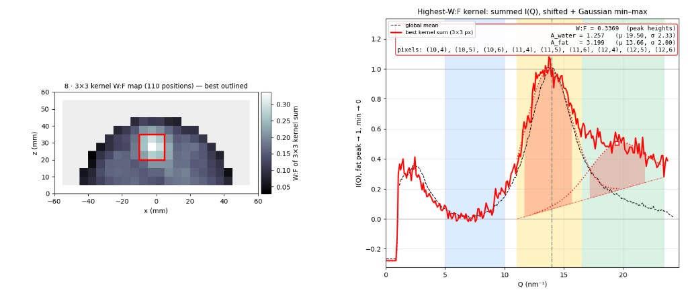{#fig-sim-kernel-dense}

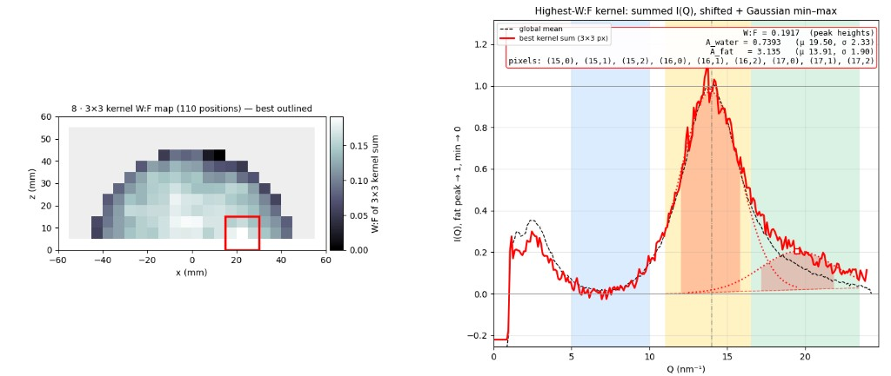{#fig-sim-kernel-dense-none}
