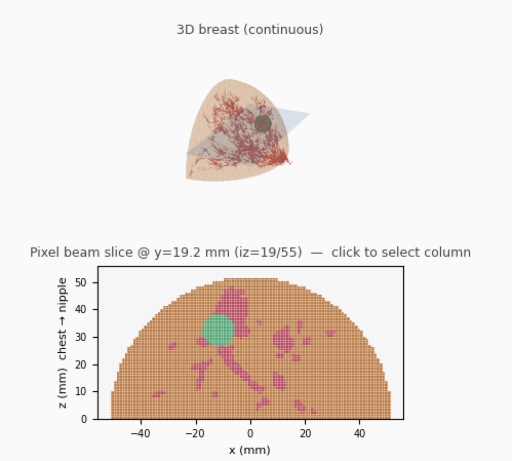
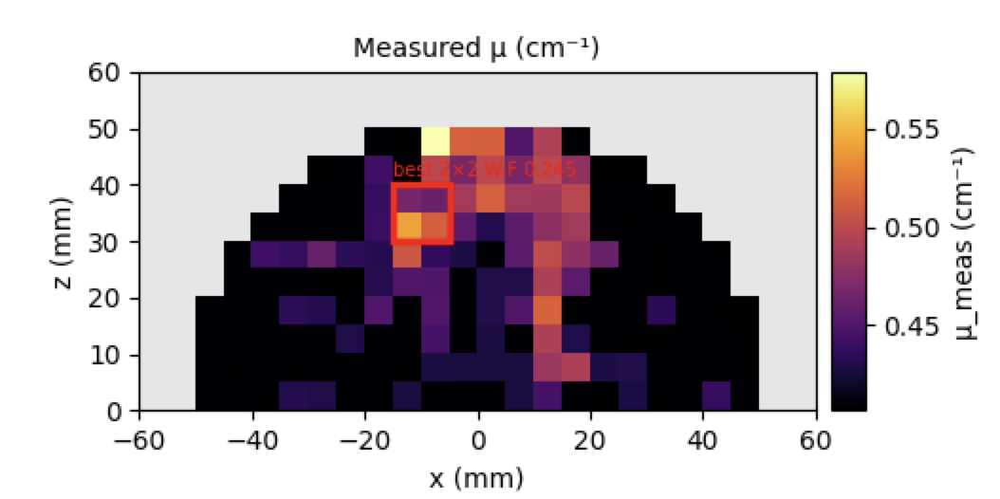
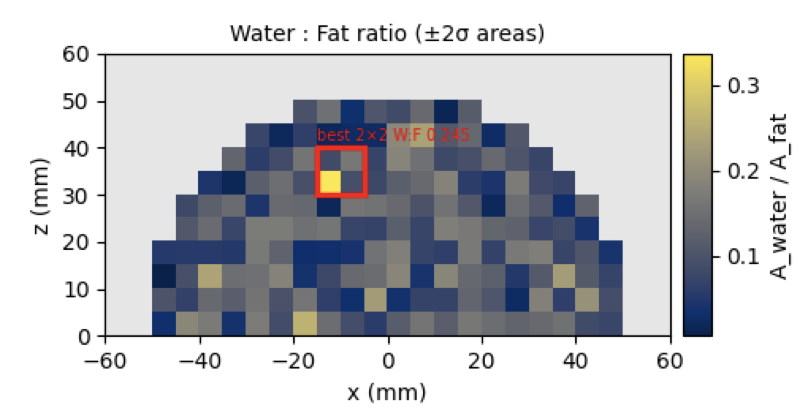
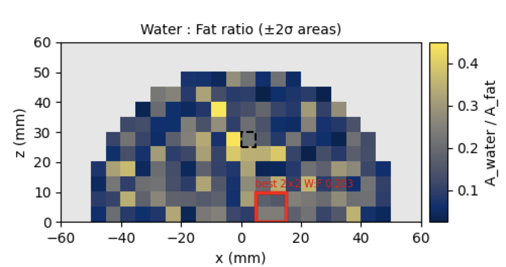

# Simulating a Human 2.0 map {#sec-simulation}

::: {.callout-note title="A worked example of the map, not a patient result"}
The map below is one virtual breast with a **10 mm** tumour. Two million photons is what the real instrument collects in **1 second**, so each
step of the map is 1 s of beam time. This breast was stepped at **5 mm**, and only where it is **2 cm or thicker**: **166 steps**, which is
**166 seconds (2 min 46 s)**. A **2 cm** tumour, searched the same way, follows the 10 mm maps. The same breast with the tumour removed, and nothing else changed, is at the end.
:::

The simulator builds a 3D breast from adipose and a branching glandular network, and can add a tumour of any chosen size. The volume used here
is a **half breast**: semi-axes 5.5 cm in x and y, height 5.5 cm, voxels of 5 mm, on a 24 × 12 × 12 grid at 0.5 cm (@fig-sim-phantom). Materials
are assigned per voxel (adipose, then glandular). This example adds a **10 mm** tumour (@fig-sim-tumour).

{#fig-sim-phantom}

{#fig-sim-tumour}

A run has two stages. First the photons interact in the breast and are stored. Then they are passed to a detector. The detector and the
sample-to-detector distance can be changed after the breast has been simulated, without repeating it. The detector here is the **CdTe Dectris
500K** that Human 2.0 will move to.

@fig-sim-one-point is one such run, 2 million photons, aimed at a **very fatty** part of this breast. About 16% of the beam is transmitted, and
the 1D curve has the fat peak near q = 14 nm⁻¹ and little water, the same shape as the fatty scans in the real data.

{#fig-sim-one-point}

## A map of every thick point

The same 2-million-photon run was repeated on the UCL cluster at every point of this breast that is 2 cm or thicker. That is the scan proposed
for Human 2.0 (@sec-mapping): leave out the thin edge, and give each remaining point one second. At 5 mm steps that is 166 points, so **2 min
46 s** of beam time, inside the 5-minute limit.

Each simulated point was then prepared exactly as a real scan: the fat peak was shifted to q = 14 nm⁻¹, and the curve was normalised the same
way. A 2 × 2 kernel, four neighbouring points, was slid over every position on the breast. The search keeps the position with the
highest Water:Fat automatically. @fig-sim-kernel is the kernel it found. Its Water:Fat is **0.245**, at pixels (9, 6),
(9, 7), (10, 6) and (10, 7). The red curve is those four points summed, and it rises through the water band where the global mean stays low.
The red box on the maps below is this kernel.

{#fig-sim-kernel}

Thickness is known from the phantom and transmission from the run, so the linear attenuation is μ = −ln(T) / thickness (@fig-sim-mu). The red
box is the kernel in @fig-sim-kernel.

{#fig-sim-mu}

The same two-Gaussian Water:Fat used on the real scans (@sec-water-fat) gives a ratio at each point (@fig-sim-wf-tumour). Most of the breast
stays low. The tumour is the exception: the red box is the kernel in @fig-sim-kernel, Water:Fat **0.245**, and it sits on the tumour. That
contrast, the tumour against the fatty tissue around it, is why the map marks this patch and not the glandular tissue.

{#fig-sim-wf-tumour}

## A 2 cm tumour

@fig-sim-tumour-2cm is a breast with a **2 cm** tumour: the green mass in the slice. The same automatic search keeps a wetter kernel (@fig-sim-kernel-2cm). Its Water:Fat is **0.279**, at pixels (11, 4), (11, 5), (12, 4) and (12, 5). The red curve rises further through the water band than the 10 mm kernel (@fig-sim-kernel).

{#fig-sim-tumour-2cm}

{#fig-sim-kernel-2cm}

## The same breast, with no tumour

@fig-sim-wf is the same breast with the tumour removed and nothing else changed. There is no patch that stands out. The same automatic
search now keeps a kernel of Water:Fat **0.203**, at pixels (13, 0), (13, 1), (14, 0) and (14, 1), the red box, and it sits on glandular tissue. A water peak does not stand out,
so this breast would fall on the fatty side of the top 15% cut (@sec-water-rich) and of the water-peak rule at 0.35 (@sec-the-rule,
@fig-missed-normal-normal). The 10 mm tumour is marked because its wettest kernel is **0.245** against **0.203**, and that kernel is the tumour. With a 2 cm tumour the same search keeps **0.279** (@fig-sim-kernel-2cm).

All 166 points were kept. The global mean of the 166 curves has Water:Fat **0.115**. Point by point the ratio is **0.096 ± 0.054** (median
0.088). The wettest 15% has Water:Fat **0.202** on its mean curve; the fattiest 15% has **0.047**. That is the same kind of summary proposed
for a real map (@sec-map-measures).

{#fig-sim-wf}
